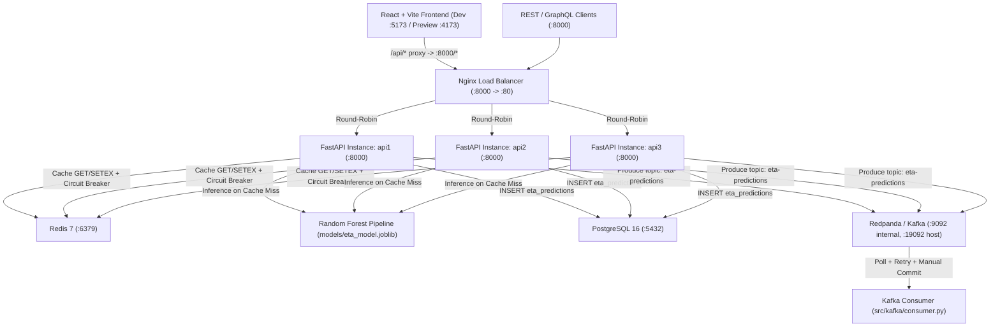

# Mini-Uber-ETA

[](https://github.com/JAYTHAKAR2004/MINI_UBER/actions/workflows/ci.yml)
[](https://github.com/JAYTHAKAR2004/MINI_UBER/actions/workflows/cd.yml)

**Mini-Uber-ETA** is a full-stack, real-time food delivery Estimated Time of Arrival (ETA) prediction platform combining supervised machine learning (`scikit-learn` Random Forest), FastAPI REST and Strawberry GraphQL APIs, Redis caching with a thread-safe circuit breaker, Redpanda (Kafka-compatible) event streaming, PostgreSQL persistence, three load-balanced API instances behind Nginx, Docker Compose orchestration, and GitHub Actions CI/CD.

The frontend provides a **Zomato-inspired food ordering interface** built as an academic demonstration so users can browse demo restaurants, customize menus, add items to a cart, place simulated orders, track order stages, and invoke live ML ETA predictions against the running backend stack.

> **Academic Project Disclaimer:** Mini-Uber-ETA is an independent academic and technical portfolio project. The Zomato-inspired frontend styling is strictly for UI demonstration; this project is not affiliated with, endorsed by, or connected to Zomato. Restaurant catalogs, menus, carts, and checkout flows run locally in the browser as demo UI (`localStorage`), whereas ETA predictions, caching, database writes, and Kafka events execute live against the backend.

---

## Table of Contents

- [Project Overview](#project-overview)
- [Key Features](#key-features)
- [Screenshots](#screenshots)
- [System Architecture](#system-architecture)
- [Technology Stack](#technology-stack)
- [Machine Learning Model](#machine-learning-model)
- [Project Setup and Installation](#project-setup-and-installation)
- [Docker Services](#docker-services)
- [API Documentation](#api-documentation)
- [Fault Tolerance and Reliability](#fault-tolerance-and-reliability)
- [CI/CD Pipeline](#cicd-pipeline)
- [Project Milestones](#project-milestones)
- [Testing and Verification](#testing-and-verification)
- [Project Directory Structure](#project-directory-structure)
- [Future Improvements](#future-improvements)
- [Author and License](#author-and-license)

---

## Project Overview

Predicting food delivery time requires handling geographic route distances, courier attributes, traffic density, weather conditions, and temporal patterns while serving low-latency responses reliably under backend load or partial dependency failures.

Mini-Uber-ETA addresses this end-to-end across three layers:

1. **Data & ML Pipeline (`src/pipeline/etl.py`, `src/models/train.py`)**: Cleans and validates delivery datasets, computes Haversine distances within India coordinate bounds, engineers clock/date features, benchmarks regression models, and serializes the selected Random Forest pipeline to `models/eta_model.joblib`.
2. **Distributed Backend (`src/api/`, `src/resilience/`, `src/messaging/`, `src/kafka/`, `nginx/`)**: Serves REST (`POST /predict`, `/health`, `/`) and GraphQL (`POST /graphql`) endpoints across three FastAPI/Uvicorn replicas load-balanced round-robin by Nginx, backed by Redis caching with circuit breaking, PostgreSQL storage (`eta_predictions`), and Redpanda event streaming (`eta-predictions`).
3. **Interactive Frontend (`frontend/`)**: A React + Vite + Tailwind CSS food-ordering experience connected to the live FastAPI backend via Axios and a Vite `/api` proxy, exposing live ETA forecasting, offline ML benchmarks, and real-time backend/load-balancer telemetry.

---

## Key Features

### Frontend (React + Vite)
- **Restaurant Discovery & Filtering**: Browse demo restaurants across Indian cities (Bengaluru, Mumbai, Hyderabad, Pune, New Delhi) with search, cuisine/category filters, Veg/Non-Veg toggles, and Dining Out filtering.
- **Restaurant Menus & Cart Management**: Interactive dish selection, quantity controls, promo code application, persistent `localStorage` cart, and slide-over cart drawer.
- **Demo Checkout & Order Tracking**: Academic demo checkout (no payment gateway) followed by an order confirmation screen and an interactive 5-stage order progress tracker (`Order confirmed` → `Restaurant preparing food` → `Pickup` → `Out for delivery` → `Delivered`).
- **Live AI ETA Prediction Page (`/predict`)**: Auto-calculates Haversine route distance and India-bounds validity, validates all 17 model inputs, calls `POST /predict`, displays the Random Forest forecast alongside an expected arrival window (`MAE ±3.21 min`), and surfaces Redis cache, PostgreSQL, and Kafka status.
- **Analytics & System Status Pages**: Visualizes offline ML comparison metrics (`reports/validation_model_comparison.csv`, `reports/final_test_metrics.csv`), live session `/predict` telemetry, `/health` round-robin replica distribution across `api1`/`api2`/`api3`, and `/graphql` status.

### Backend, Data & Infrastructure
- **FastAPI REST API (`src/api/main.py`)**: Inference (`POST /predict`), health (`GET /health`), root metadata (`GET /`), and prediction record CRUD handlers (`GET /predictions`, `GET /predictions/{prediction_id}`, `PATCH /predictions/{prediction_id}`, `DELETE /predictions/{prediction_id}` in the current workspace source).
- **Strawberry GraphQL API (`src/api/graphql_schema.py`)**: Mounted at `/graphql` exposing `hello`, `projectInfo`, and `health` queries.
- **Redis Caching (`redis:7-alpine`)**: Deterministic SHA-256 cache key (`eta:rf-v1:<hash>`) with a `300s` TTL and `HIT`/`MISS`/`BYPASS` reporting.
- **Kafka-Compatible Event Streaming (`redpandadata/redpanda`)**: Producer publishes `ETA_PREDICTION_CREATED` events to the `eta-predictions` topic; standalone consumer (`src/kafka/consumer.py`) reads with `group.id="eta-analytics-consumer"`, exponential backoff retries, and manual synchronous offset commits.
- **PostgreSQL Persistence (`postgres:16-bookworm`)**: Stores prediction inputs, predicted ETA, model name, and UTC timestamp in the `eta_predictions` table via SQLAlchemy (`src/models/db_models.py`) and `psycopg`.
- **Heterogeneous Data Ingestion (`src/pipeline/etl.py`)**: Supports `.csv`, `.json`, `.jsonl`, and `.parquet` / `.pq` inputs with schema/coordinate validation and missing-value reporting (`reports/etl_missing_values.csv`).
- **Nginx Round-Robin Load Balancing (`nginx/nginx.conf`)**: Distributes traffic across `api1:8000`, `api2:8000`, and `api3:8000`.
- **Fault Tolerance (`src/resilience/circuit_breaker.py`)**: Thread-safe `CLOSED`/`OPEN`/`HALF_OPEN` circuit breaker guarding Redis operations plus producer delivery timeouts and consumer retry logic.
- **Containerization & CI/CD**: 7-service `docker-compose.yml` orchestration, `Dockerfile` with `/health` healthcheck, GitHub Actions CI (`ci.yml`), and automated GHCR Docker image publishing (`cd.yml`).

---

## Screenshots

No UI screenshots are currently committed in the repository. To include them later, save PNG/JPG captures under `docs/screenshots/` and reference them with relative paths below.

| View | Suggested Path | Status |
| :--- | :--- | :--- |
| Homepage | `docs/screenshots/homepage.png` | *Add screenshot to `docs/screenshots/`* |
| Restaurant Listing | `docs/screenshots/restaurant-listing.png` | *Add screenshot to `docs/screenshots/`* |
| Restaurant Menu | `docs/screenshots/restaurant-menu.png` | *Add screenshot to `docs/screenshots/`* |
| Cart and Checkout | `docs/screenshots/cart-checkout.png` | *Add screenshot to `docs/screenshots/`* |
| Order Tracking | `docs/screenshots/order-tracking.png` | *Add screenshot to `docs/screenshots/`* |
| ETA Prediction Result | `docs/screenshots/eta-prediction.png` | *Add screenshot to `docs/screenshots/`* |
| System Architecture / Analytics | `docs/screenshots/analytics-dashboard.png` | *Add screenshot to `docs/screenshots/`* |
| System Status Dashboard | `docs/screenshots/system-status.png` | *Add screenshot to `docs/screenshots/`* |

---

## System Architecture

Client requests from the React frontend are proxied by Vite (`/api/*` → `http://localhost:8000/*`) to the Nginx reverse proxy, which load-balances incoming REST and GraphQL traffic round-robin across three identical FastAPI container replicas (`api1`, `api2`, `api3`). Each API replica shares the trained `eta_model.joblib` artifact and communicates with Redis (cache + circuit breaker), PostgreSQL (durable storage), and Redpanda (event streaming).



### Request Flow for `POST /predict`
1. FastAPI validates the 17 optional `ETAPredictionRequest` fields (returning `422` if all fields are `null` or violate bounds).
2. A deterministic SHA-256 key (`eta:rf-v1:<hash>`) is generated and looked up in Redis via `CircuitBreaker` (`1s` socket/connect timeout).
3. On cache `MISS` or `BYPASS`, the serialized `scikit-learn` Random Forest pipeline predicts `Time_taken (min)` (clamped to `>= 0`, rounded to 2 decimal places). If the circuit allows, the result is cached in Redis with a `300s` TTL.
4. The prediction record (`input_features`, `predicted_eta_minutes`, `model_name="Random Forest"`) is committed to PostgreSQL `eta_predictions`.
5. An `ETA_PREDICTION_CREATED` JSON event is published to the Redpanda `eta-predictions` topic (`5000ms` message timeout / `5s` flush), returning `PUBLISHED` or `FAILED` without failing the HTTP response if Kafka is unavailable.

---

## Technology Stack

Versions listed below are verified from `frontend/package.json`, `requirements.txt`, `Dockerfile`, `docker-compose.yml`, and `.github/workflows/`.

| Category | Technology | Verified Version / Details |
| :--- | :--- | :--- |
| **Frontend** | React, React DOM, React Router DOM | `^18.3.1` (`react`, `react-dom`), `^6.28.0` (`react-router-dom`) |
| | Vite, Tailwind CSS, PostCSS, Autoprefixer | `^6.0.7` (`vite`), `^3.4.17` (`tailwindcss`), `^8.4.49`, `^10.4.20` |
| | Axios, Recharts, Lucide React | `^1.7.9`, `^2.15.0`, `^0.469.0` |
| **Backend** | Python | `3.12` (`python:3.12-slim` in `Dockerfile`, `3.12` in CI) |
| | FastAPI, Uvicorn, Pydantic | `0.165.0`, `0.54.0`, `2.14.4` |
| | Strawberry GraphQL, GraphQL-Core | `0.341.2`, `3.3.2` |
| | SQLAlchemy, psycopg | `2.1.9`, `3.3.9` (`psycopg-binary==3.3.9`) |
| **Machine Learning** | scikit-learn, pandas, NumPy, SciPy, joblib | `1.9.1`, `3.1.1`, `2.5.5`, `1.18.1`, `1.6.0` |
| **Database** | PostgreSQL | `postgres:16-bookworm` |
| **Messaging** | Redpanda (Kafka-compatible), confluent-kafka | `redpandadata/redpanda:latest`, `2.16.2` |
| **Caching** | Redis, redis-py | `redis:7-alpine`, `8.1.0` |
| **Load Balancing** | Nginx | `nginx:alpine` (Round-Robin upstream across 3 API containers) |
| **Containerization** | Docker, Docker Compose | Multi-container stack (`Dockerfile`, `docker-compose.yml`) |
| **CI/CD** | GitHub Actions, GitHub Container Registry | `ci.yml` (`compileall`, `pytest`), `cd.yml` (`ghcr.io`, `docker/build-push-action@v6`) |

---

## Machine Learning Model

### Dataset & Target
- **Source Files**: `data/raw/train.parquet` and `data/raw/test.parquet` → processed into `data/processed/train_processed.parquet` (36,467 training rows) and `data/processed/test_processed.parquet`.
- **Target Variable**: `Time_taken (min)` — delivery duration in minutes (validated to lie within `[1, 180]` in `src/pipeline/etl.py`).

### Preprocessing & Feature Engineering (`src/pipeline/etl.py`, `src/models/train.py`)
- **Numeric Features (11)**: `Delivery_person_Age`, `Delivery_person_Ratings` (outside `[1, 5]` coerced to `NaN`), `Vehicle_condition`, `multiple_deliveries`, `distance_km` (Haversine distance computed when both restaurant and delivery coordinates fall inside India bounds: latitude `[6, 38]`, longitude `[68, 98]`), `coordinates_valid` (`0`/`1`), `order_time_missing` (`0`/`1`), `order_hour` (`0–23`), `order_day` (`1–31`), `order_month` (`1–12`), `order_weekday` (`0–6`).
- **Categorical Features (6)**: `Weather_conditions`, `Road_traffic_density`, `Type_of_order`, `Type_of_vehicle`, `Festival`, `City` (trimmed strings).
- **Scikit-learn `ColumnTransformer` Pipeline**:
  - Numeric pipeline: `SimpleImputer(strategy="median", add_indicator=True)` → `StandardScaler()`
  - Categorical pipeline: `SimpleImputer(strategy="most_frequent")` → `OneHotEncoder(handle_unknown="ignore")`

### Model Comparison & Selection
Models were evaluated on an 80/20 train-validation split (`random_state=42`) in `src/models/train.py` and recorded in `reports/validation_model_comparison.csv`:

| Model | Validation MAE (min) | Validation RMSE (min) | Validation R² | Selected |
| :--- | :---: | :---: | :---: | :---: |
| **Random Forest** (`n_estimators=200`, `min_samples_leaf=2`) | **3.257** | **4.126** | **0.8070** | **Yes** |
| Gradient Boosting (`n_estimators=150`, `lr=0.05`, `max_depth=3`) | 3.790 | 4.747 | 0.7446 | No |
| Linear Regression | 4.852 | 6.099 | 0.5784 | No |

> **Note:** The comparison metrics above are **offline validation split results** from `reports/validation_model_comparison.csv` (not production guarantees). After selection, `Random Forest` was refit on the complete `train_processed.parquet` dataset and evaluated on the held-out `test_processed.parquet` split (`reports/final_test_metrics.csv`): **MAE `3.209` min**, **RMSE `4.075` min**, **R² `0.8114`**.

**Why Random Forest Was Selected:** Random Forest achieved the lowest validation MAE (`3.257` vs `3.790` and `4.852`) and highest R² (`0.8070`), capturing non-linear interactions across traffic density, weather conditions, courier ratings, vehicle condition, order hour, and Haversine distance better than linear and shallow boosted baselines.

---

## Project Setup and Installation

### Prerequisites
- **Docker Desktop** (or Docker Engine with Docker Compose v2)
- **Node.js & npm** (for running or building the Vite React frontend)
- **Python 3.12+** (optional locally; required only if running ETL, training, standalone unit scripts, or the local Kafka consumer outside Docker)

### 1. Clone the Repository
```bash
git clone https://github.com/JAYTHAKAR2004/MINI_UBER.git
cd Mini-Uber-ETA
```

*(Adjust the folder name if you cloned into `MINI_UBER` directly.)*

### 2. Configure Environment Variables
Create the root `.env` file from `.env.example`:

```bash
cp .env.example .env
```

Verified variables in `.env.example`:
```env
APP_NAME=Mini-Uber-ETA
APP_ENV=development
DEBUG=true

POSTGRES_DB=eta_db
POSTGRES_USER=eta_user
POSTGRES_PASSWORD=2004
POSTGRES_HOST=localhost
POSTGRES_PORT=5432

REDIS_HOST=localhost
REDIS_PORT=6379

KAFKA_BOOTSTRAP_SERVERS=localhost:9092
KAFKA_ORDER_TOPIC=order_events
KAFKA_LOCATION_TOPIC=location_events

API_HOST=0.0.0.0
API_PORT=8000
```

Configure the frontend environment in `frontend/.env` from `frontend/.env.example`:
```bash
cp frontend/.env.example frontend/.env
```

Verified variables in `frontend/.env.example`:
```env
VITE_API_BASE_URL=http://localhost:8000
VITE_USE_PROXY=true
```

### 3. Obtain or Train the ML Model Artifact
Because `*.joblib` files are excluded in `.gitignore`, ensure `models/eta_model.joblib` exists before building the API containers:
- **Option A — Download release artifact** (same URL used by `.github/workflows/cd.yml`):
  ```bash
  mkdir -p models
  curl -fL https://github.com/JAYTHAKAR2004/MINI_UBER/releases/download/v1.0.0/eta_model.joblib -o models/eta_model.joblib
  ```
- **Option B — Run local ETL and model training**:
  ```bash
  pip install -r requirements.txt
  python src/pipeline/etl.py
  python src/models/train.py
  ```

### 4. Start Backend Services with Docker Compose
From the repository root:
```bash
docker compose up -d --build
```

Verify that containers are healthy and Nginx responds:
```bash
docker compose ps
curl http://localhost:8000/health
```

### 5. Install Dependencies & Start the Frontend
From `frontend/`:
```bash
cd frontend
npm install
npm run dev
```

Or build and serve the production bundle locally:
```bash
cd frontend
npm run build
npm run preview
```

### 6. Accessing the Application
- **Frontend (Vite Dev Server)**: `http://localhost:5173`
- **Frontend (Vite Preview Server)**: `http://localhost:4173`
- **Backend API & Nginx Load Balancer**: `http://localhost:8000`
- **Swagger / OpenAPI Docs**: `http://localhost:8000/docs`
- **GraphQL Endpoint / GraphiQL**: `http://localhost:8000/graphql`
- **Optional Local Kafka Consumer** (from repo root, connecting to Redpanda external listener):
  ```bash
  KAFKA_BOOTSTRAP_SERVERS=localhost:19092 python src/kafka/consumer.py
  ```

---

## Docker Services

Defined in `docker-compose.yml`:

| Service | Container Name | Image / Build | Exposed Host Ports | Purpose & Configuration |
| :--- | :--- | :--- | :--- | :--- |
| `postgres` | `mini_uber_postgres` | `postgres:16-bookworm` | `5432:5432` | Persistent database (`eta_predictions` table); volume `postgres_data`; `pg_isready` healthcheck |
| `redis` | `mini_uber_redis` | `redis:7-alpine` | `6379:6379` | Prediction cache with `--appendonly yes`; volume `redis_data`; `redis-cli ping` healthcheck |
| `redpanda` | `mini_uber_kafka` | `redpandadata/redpanda:latest` | `19092:19092`, `9644:9644` | Kafka-compatible broker (`redpanda:9092` internal, `localhost:19092` host, `9644` admin); volume `redpanda_data` |
| `api1` | `mini_uber_api1` | `Dockerfile` (`python:3.12-slim`) | Internal `8000` | FastAPI + Uvicorn worker #1 with `/health` check |
| `api2` | `mini_uber_api2` | `Dockerfile` (`python:3.12-slim`) | Internal `8000` | FastAPI + Uvicorn worker #2 with `/health` check |
| `api3` | `mini_uber_api3` | `Dockerfile` (`python:3.12-slim`) | Internal `8000` | FastAPI + Uvicorn worker #3 with `/health` check |
| `nginx` | `mini_uber_nginx` | `nginx:alpine` | `8000:80` | Round-robin reverse proxy forwarding `/` to `api1`, `api2`, `api3` |

---

## API Documentation

### 1. Root Metadata — `GET /`
Returns API status, version, and the serving container hostname (`instance`).

**Example Response (`200 OK`):**
```json
{
  "message": "Mini Uber ETA Prediction API",
  "instance": "04c93d311e2d",
  "status": "running",
  "version": "1.3.0",
  "docs": "/docs"
}
```

### 2. Health Check — `GET /health`
Reports model load state, responding API replica ID, and current Redis circuit breaker state.

**Example Response (`200 OK`):**
```json
{
  "status": "healthy",
  "model_loaded": true,
  "instance": "8942f5a12061",
  "redis_circuit": "CLOSED"
}
```

### 3. Predict Delivery ETA — `POST /predict`
Runs cache lookup (Redis), Random Forest inference on miss (`models/eta_model.joblib`), PostgreSQL insert (`eta_predictions`), and Redpanda event publish (`eta-predictions`).

**Supported `ETAPredictionRequest` Fields (all `Optional`; at least one non-null field required):**

| Field | Type | Constraints / Allowed Values |
| :--- | :--- | :--- |
| `Delivery_person_Age` | `float` | Courier age |
| `Delivery_person_Ratings` | `float` | Courier rating (`1.0`–`5.0` in training data) |
| `Vehicle_condition` | `float` | Integer-coded condition (`0`–`3`) |
| `multiple_deliveries` | `float` | Number of concurrent deliveries (`0`–`3`) |
| `distance_km` | `float` | `>= 0` (Haversine distance in km) |
| `coordinates_valid` | `int` | `0` or `1` |
| `order_time_missing` | `int` | `0` or `1` |
| `order_hour` | `float` | `0` to `23` |
| `order_day` | `int` | `1` to `31` |
| `order_month` | `int` | `1` to `12` |
| `order_weekday` | `int` | `0` (Monday) to `6` (Sunday) |
| `Weather_conditions` | `string` | `Sunny`, `Cloudy`, `Windy`, `Fog`, `Sandstorms`, `Stormy` |
| `Road_traffic_density` | `string` | `Low`, `Medium`, `High`, `Jam` |
| `Type_of_order` | `string` | `Meal`, `Snack`, `Drinks`, `Buffet` |
| `Type_of_vehicle` | `string` | `motorcycle`, `scooter`, `electric_scooter`, `bicycle` |
| `Festival` | `string` | `No`, `Yes` |
| `City` | `string` | `Metropolitian` *(model dataset spelling)*, `Urban`, `Semi-Urban` |

**Example Request JSON:**
```json
{
  "Delivery_person_Age": 28,
  "Delivery_person_Ratings": 4.7,
  "Vehicle_condition": 2,
  "multiple_deliveries": 0,
  "distance_km": 5.28,
  "coordinates_valid": 1,
  "order_time_missing": 0,
  "order_hour": 21,
  "order_day": 23,
  "order_month": 11,
  "order_weekday": 0,
  "Weather_conditions": "Cloudy",
  "Road_traffic_density": "Medium",
  "Type_of_order": "Meal",
  "Type_of_vehicle": "motorcycle",
  "Festival": "No",
  "City": "Metropolitian"
}
```

**Example Response JSON (`200 OK`):**
```json
{
  "prediction_id": 23,
  "predicted_eta_minutes": 21.12,
  "unit": "minutes",
  "model": "Random Forest",
  "storage": "PostgreSQL",
  "cache": {
    "status": "MISS",
    "ttl_seconds": 300,
    "circuit_state": "CLOSED"
  },
  "kafka": {
    "topic": "eta-predictions",
    "status": "PUBLISHED"
  },
  "processing_time_seconds": 0.189
}
```

**Error Responses:**
- `422 Unprocessable Entity`: All fields omitted/`null`, or numeric bounds violated.
- `503 Service Unavailable`: ML model unavailable (`"ETA model is not available."`) or PostgreSQL commit failure (`"Prediction generated, but database storage failed."`).
- `500 Internal Server Error`: Unexpected inference/runtime exception.

*(Note: The current workspace `src/api/main.py` also defines `GET /predictions`, `GET /predictions/{prediction_id}`, `PATCH /predictions/{prediction_id}`, and `DELETE /predictions/{prediction_id}` for stored PostgreSQL records; rebuild Docker images with `docker compose up -d --build` to expose those local additions in containers.)*

### 4. GraphQL Endpoint — `POST /graphql`
Powered by Strawberry GraphQL (`src/api/graphql_schema.py`).

**Example Request JSON:**
```json
{
  "query": "query { hello projectInfo health }"
}
```

**Example Response JSON (`200 OK`):**
```json
{
  "data": {
    "hello": "Welcome to Mini Uber ETA GraphQL API!",
    "projectInfo": "Real-time Food Delivery ETA Prediction System",
    "health": "Mini Uber ETA API is healthy"
  }
}
```

---

## Fault Tolerance and Reliability

Implemented in `src/resilience/circuit_breaker.py`, `src/api/main.py`, `src/messaging/kafka_producer.py`, and `src/kafka/consumer.py` (documented in `reports/P9_Fault_Tolerance_Report.md`):

- **Circuit Breaker (`CircuitBreaker`)**:
  - **States**: `CLOSED` (requests permitted), `OPEN` (requests blocked for `recovery_timeout=5s` after `failure_threshold=3` consecutive failures), and `HALF_OPEN` (permits a single test request after recovery timeout; transitions back to `CLOSED` on success or `OPEN` on failure).
  - **Thread Safety**: Protected by `threading.Lock()`.
- **Redis Timeout & Cache Bypass**:
  - `redis.Redis` configured with `socket_connect_timeout=1` and `socket_timeout=1`.
  - On `redis.RedisError`, `record_failure()` increments failure count, reads return `(None, "BYPASS")`, writes return `False`, and `POST /predict` falls back cleanly to live Random Forest inference.
- **Kafka Producer Timeout Handling**:
  - `confluent_kafka.Producer` configured with `message.timeout.ms=5000`, a delivery callback verifying `err is None`, and `producer.flush(5)`. Exceptions are caught and surfaced as `kafka.status = "FAILED"` without crashing `POST /predict`.
- **Kafka Consumer Retries & Manual Offset Commit**:
  - `enable.auto.commit=False` on consumer group `eta-analytics-consumer`.
  - Processes each message up to `MAX_ATTEMPTS = 3` with exponential backoff (`INITIAL_BACKOFF = 1`, retry delays of `1s` and `2s`).
  - Calls synchronous `consumer.commit(message=msg, asynchronous=False)` **only after** successful processing; on exhausted retries, halts without committing the failed offset so it can be reprocessed.

> **Verification Scope Distinction:** Unit and simulation scripts (`test_circuit_breaker.py` and `test_consumer_retry.py`) verify the state machine and retry backoff timing. Live Redis outage/recovery and live Kafka broker outage integration tests have **not** been executed; those failure paths are verified by code inspection only.

---

## CI/CD Pipeline

| Workflow | File | Triggers | What It Does |
| :--- | :--- | :--- | :--- |
| **Mini Uber ETA - CI** | `.github/workflows/ci.yml` | Push / PR to `main` or `master`, `workflow_dispatch` | Checks out repo, sets up Python `3.12`, installs `requirements.txt` and `pytest`, runs `python -m compileall -q src`, and runs `pytest -v` if a `tests/` directory is present |
| **Mini Uber ETA - CD** | `.github/workflows/cd.yml` | Completion of `Mini Uber ETA - CI` with `success` on `main`, or `workflow_dispatch` | Downloads `eta_model.joblib` from GitHub Release `v1.0.0`, logs in to `ghcr.io`, and builds & pushes `ghcr.io/jaythakar2004/mini-uber-eta` tagged `latest` and commit SHA |

> **Scope Note:** Automated CI validates syntax compilation and builds/publishes the backend Docker image to GHCR. Automated deployment to an external production server is **not** configured.

---

## Project Milestones

| Milestone | Scope | Implementation Status in Repository |
| :--- | :--- | :--- |
| **P1** | REST API CRUD | Core FastAPI service (`GET /`, `GET /health`, `POST /predict`, `/docs`) with PostgreSQL persistence via SQLAlchemy; prediction CRUD endpoints (`/predictions`) added in workspace `src/api/main.py` |
| **P2** | GraphQL API | Implemented with Strawberry GraphQL (`src/api/graphql_schema.py`) mounted at `/graphql` |
| **P3** | Kafka Producer–Consumer | Producer (`src/messaging/kafka_producer.py`) publishes to `eta-predictions`; consumer (`src/kafka/consumer.py`) subscribes with manual offset commits |
| **P4** | CI/CD Pipeline | GitHub Actions CI (`ci.yml`) and CD (`cd.yml`) configured for Python compilation, pytest, and GHCR Docker publishing |
| **P5** | Database Sharding and Replication | Evaluated/documented in the project milestone sequence; current `docker-compose.yml` deploys a single `postgres:16-bookworm` container (`mini_uber_postgres`) rather than a multi-shard/replicated topology |
| **P6** | Heterogeneous Data Ingestion | `load_dataset` in `src/pipeline/etl.py` supports `.csv`, `.json`, `.jsonl`, and `.parquet`/`.pq` formats with validation and missing-value reporting |
| **P7** | Redis Caching | Deterministic SHA-256 input caching in `src/api/main.py` (`CACHE_TTL = 300s`, `HIT`/`MISS`/`BYPASS` telemetry) |
| **P8** | Round-Robin Load Balancing | `nginx/nginx.conf` balances requests round-robin across `api1:8000`, `api2:8000`, and `api3:8000` |
| **P9** | Fault Tolerance | Thread-safe `CircuitBreaker`, Redis `1s` timeouts & cache bypass, Kafka `5000ms` producer timeout, and consumer exponential backoff retries (`reports/P9_Fault_Tolerance_Report.md`) |
| **P10** | Docker and Continuous Deployment | 7-service `docker-compose.yml`, `Dockerfile`, and GHCR publishing workflow (`reports/P10_Docker_CI_CD_Report.md`) |

---

## Testing and Verification

Verified checks observed in the repository and reports:

- **Circuit Breaker Unit Test (`python test_circuit_breaker.py`)** *(documented in `reports/P9_Fault_Tolerance_Report.md`)*:
  - Opening after 3 failures, blocking requests while `OPEN`, allowing one probe request in `HALF_OPEN`, closing on recovery, and reopening on failed recovery all passed.
- **Consumer Retry Simulation (`python test_consumer_retry.py`)** *(documented in `reports/P9_Fault_Tolerance_Report.md`)*:
  - Simulated failures executed 3 attempts with `[1, 2]` second backoff delays and passed.
- **Docker Compose & Load Balancer Verification** *(documented in `reports/P10_Docker_CI_CD_Report.md`)*:
  - Docker Compose configuration validated; PostgreSQL, Redis, and all 3 API containers reported healthy.
  - 9 consecutive `GET http://localhost:8000/health` requests rotated cleanly across `API1 → API2 → API3` (3 requests per replica).
- **Frontend Production Build & Live `POST /predict` Check**:
  - `npm run build` in `frontend/` succeeded (`vite build`, 2088 modules transformed).
  - Live `POST /predict` verified directly against `http://localhost:8000/predict` (`200 OK`, `cache.status: "MISS"`, `storage: "PostgreSQL"`, `kafka.status: "PUBLISHED"`) and via Vite `/api/predict` proxy (`200 OK`, `cache.status: "HIT"`).

### Known Limitations
- The `tests/` directory is currently empty; `test_circuit_breaker.py` and `test_consumer_retry.py` live at the repository root, so CI runs `pytest -v` only after tests are placed in `tests/`.
- Live Redis outage/recovery and live Kafka failure-path integration tests have not been executed.
- The frontend food ordering catalog, cart, checkout, and tracking steps are client-side academic demo UI (`localStorage`), with no real payment or merchant backend.
- `docker-compose.yml` runs a single PostgreSQL container and does not deploy a frontend container or remote production server.

---

## Project Directory Structure

```text
Mini-Uber-ETA/
├── .github/
│   └── workflows/
│       ├── cd.yml                      # GHCR Docker build & publish workflow
│       └── ci.yml                      # Python 3.12 compile & pytest CI workflow
├── data/
│   ├── processed/
│   │   ├── test_processed.parquet
│   │   └── train_processed.parquet
│   └── raw/
│       ├── test.parquet
│       └── train.parquet
├── frontend/                           # React 18 + Vite Zomato-inspired UI
│   ├── public/
│   ├── src/
│   │   ├── components/
│   │   ├── context/
│   │   ├── data/
│   │   ├── hooks/
│   │   ├── layouts/
│   │   ├── pages/
│   │   ├── services/
│   │   └── utils/
│   ├── .env.example
│   ├── index.html
│   ├── package.json
│   ├── tailwind.config.js
│   └── vite.config.js
├── models/                             # Holds gitignored eta_model.joblib
├── nginx/
│   └── nginx.conf                      # Round-robin upstream across api1, api2, api3
├── reports/
│   ├── etl_missing_values.csv
│   ├── final_test_metrics.csv
│   ├── P9_Fault_Tolerance_Report.md
│   ├── P10_Docker_CI_CD_Report.md
│   └── validation_model_comparison.csv
├── src/
│   ├── api/
│   │   ├── graphql_schema.py           # Strawberry GraphQL schema
│   │   └── main.py                     # FastAPI REST + GraphQL + ML inference app
│   ├── kafka/
│   │   └── consumer.py                 # Retry + manual commit Kafka consumer
│   ├── messaging/
│   │   └── kafka_producer.py           # Redpanda/Kafka event producer
│   ├── models/
│   │   ├── db_models.py                # SQLAlchemy ETAPrediction model
│   │   └── train.py                    # Model training & evaluation pipeline
│   ├── pipeline/
│   │   └── etl.py                      # Heterogeneous data ingestion & feature ETL
│   ├── resilience/
│   │   └── circuit_breaker.py          # Thread-safe CircuitBreaker implementation
│   └── database.py                     # PostgreSQL SQLAlchemy engine & session setup
├── .dockerignore
├── .env.example
├── .gitignore
├── docker-compose.yml
├── Dockerfile
├── README.md
├── requirements.txt
├── test_circuit_breaker.py
└── test_consumer_retry.py
```

---

## Future Improvements

*(Proposed work — not yet implemented)*
- **Move Unit Tests into `tests/` & Expand Coverage**: Relocate `test_circuit_breaker.py` and `test_consumer_retry.py` into `tests/` with `pytest` tests for FastAPI endpoints and ETL transforms so GitHub Actions CI executes them automatically.
- **Live Fault-Injection Testing**: Execute containerized chaos/outage tests simulating Redis and Redpanda downtime and recovery.
- **PostgreSQL Replication / Sharding Topology**: Add primary–replica or partitioned PostgreSQL services to `docker-compose.yml` to exercise database scaling directly in the Compose stack.
- **Observability & Metrics**: Add Prometheus metrics and Grafana dashboards for API latency, Redis hit ratio, circuit breaker transitions, and Kafka consumer lag.
- **Production Deployment & Frontend Containerization**: Add a containerized frontend service (or Nginx static serving) and automated deployment target beyond GHCR image publishing.

---

## Author and License

- **Author:** Jay Thakar
- **GitHub:** [https://github.com/JAYTHAKAR2004](https://github.com/JAYTHAKAR2004)
- **Repository:** [https://github.com/JAYTHAKAR2004/MINI_UBER](https://github.com/JAYTHAKAR2004/MINI_UBER)
- **License:** No license has been specified in this repository.

